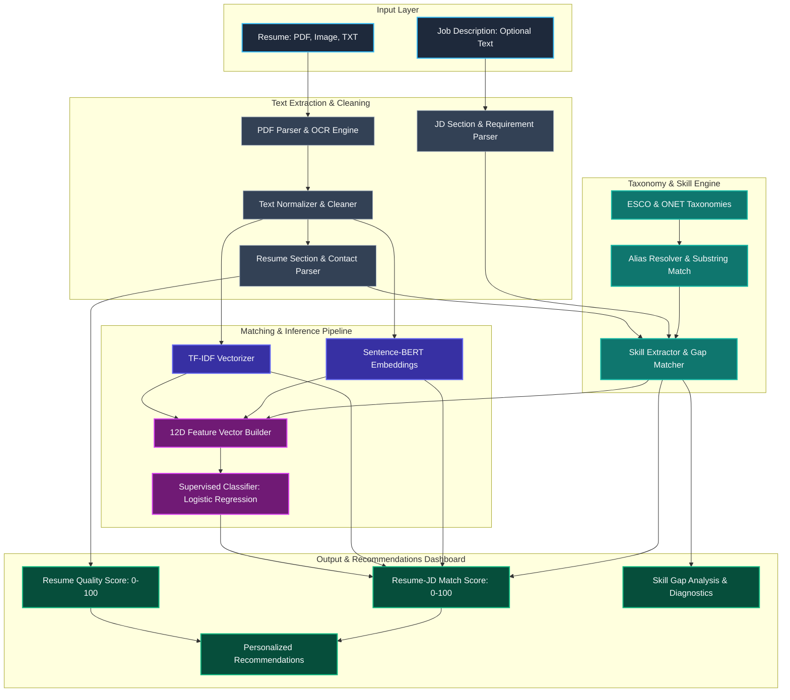

# 🎯 ResumeX — AI Resume Analyzer & Job Fit Matcher

[](https://www.python.org/downloads/)
[](https://streamlit.io)
[](https://pytorch.org)
[](https://huggingface.co)
[](https://www.docker.com/)
[](LICENSE)

**Make your resume stronger and stand out to employers.**

**ResumeX** is an intelligent, fully local NLP and machine learning platform engineered to audit resumes, extract skills against standardized global taxonomies, identify qualification gaps, and calculate transparent, explainable alignment against target job descriptions—**completely free of external cloud LLM APIs or recurring token costs**.

---

## 📌 Table of Contents

- [Overview](#-overview)
- [Key Features](#-key-features)
- [System Architecture](#-system-architecture)
- [Machine Learning & Scoring Pipeline](#-machine-learning--scoring-pipeline)
  - [Taxonomy & Skill Extraction](#taxonomy--skill-extraction)
  - [Lexical & Semantic Matching](#lexical--semantic-matching)
  - [Feature Engineering & Dimension-Aware Inference](#feature-engineering--dimension-aware-inference)
  - [Model Performance & Evaluation](#model-performance--evaluation)
  - [Explainable Hybrid Scorer](#explainable-hybrid-scorer)
- [Project Directory Structure](#-project-directory-structure)
- [Getting Started](#-getting-started)
  - [Prerequisites](#prerequisites)
  - [Option 1: Docker (Recommended)](#option-1-docker-recommended)
  - [Option 2: Local Environment Setup](#option-2-local-environment-setup)
- [Running the Pipelines](#-running-the-pipelines)
  - [1. Data Ingestion](#1-data-ingestion)
  - [2. Skill Taxonomy Preparation](#2-skill-taxonomy-preparation)
  - [3. Model Training & Benchmarking](#3-model-training--benchmarking)
  - [4. Running Automated Tests](#4-running-automated-tests)
- [Configuration & Heuristics](#-configuration--heuristics)
- [Limitations & Ethical Considerations](#-limitations--ethical-considerations)
- [Acknowledgments](#-acknowledgments)

---

## 💡 Overview

Modern recruitment systems filter out qualified candidates due to minor phrasing discrepancies, missing technical keywords, poor formatting, or unquantified achievements. Job seekers often struggle to determine whether their resume effectively aligns with job descriptions or passes automated screening.

**ResumeX** solves this by providing:
1. **Resume Quality & Hygiene Audit**: Instant feedback on contact info, structure, word choice, quantification, bullet length, passive voice, and formatting.
2. **Standardized Skill Gap Analysis**: Maps resume text and job requirements to standardized ESCO (European Skills, Competences, Qualifications and Occupations) and O*NET skill taxonomies.
3. **Hybrid Alignment Scoring**: Combines lexical overlap (TF-IDF), contextual semantics (Sentence-BERT), skill coverage, experience, and supervised machine learning into an explainable 0–100 match score.
4. **Personalized Recommendations Engine**: Generates role-targeted, prioritized suggestions with clear rationale and actionable fixes.
5. **Privacy First**: 100% local processing. No candidate data is sent to external proprietary LLMs or third-party servers.

---

## ✨ Key Features

### 1. 🔍 Deep Resume Quality & Hygiene Audit
Scans resumes across multiple structural and stylistic dimensions, returning prioritized issue cards with severity ratings (**Critical**, **High**, **Medium**, **Minor**), location tags, and exact remediation solutions:
- **Contact Completeness**: Verifies email, phone number, LinkedIn, and GitHub links. Flags missing core sections (*Experience, Education, Skills, Projects*).
- **Writing & Style Analysis**: Detects overused buzzwords and empty clichés (*"team player"*, *"hardworking"*, *"results-driven"*) and recommends evidence-based replacements.
- **Repetitive & Weak Phrasing**: Identifies repetitive action verbs and flags passive duty statements (*"responsible for"*, *"duties included"*).
- **Quantification Audit**: Checks whether bullet points demonstrate impact with metrics (`%`, `$`, scale, multipliers, user counts).
- **Bullet Length & Density**: Flags overly long bullets (>40 words) that hurt readability, as well as under-informative short lines.
- **Privacy & Bias Protection**: Flags personal details (*Date of Birth, Age, Marital Status, Gender, Nationality*) that should not appear on modern professional resumes.
- **Formatting Consistency**: Verifies date format consistency across timelines and flags mixed tense usage in past experience sections.

### 2. 🎯 Job Description Alignment (Optional Mode)
When a Target Job Description is supplied, ResumeX runs an in-depth comparative audit:
- **Standardized Skill Gap Analysis**: Uses taxonomy-backed matching to categorize candidate skills into **Matched Required**, **Missing Required**, and **Missing Preferred** competencies.
- **Dual Matching Engine**:
  - *Lexical Alignment (TF-IDF)*: Measures exact keyword vocabulary overlap.
  - *Semantic Alignment (Sentence-BERT)*: Captures contextual similarity even when phrasing differs (e.g., *"Kubernetes orchestration"* vs. *"container deployment"*).
- **Experience & Education Verification**: Automatically compares job requirements against resume qualifications and identifies discrepancies.

### 3. 💡 Personalized Recommendations Engine
Generates custom, prioritized recommendations tailored to the candidate's target role and career level (*Entry-Level, Mid-Level, Senior, Lead, Executive*):
- **Priority Tiering**: High, Medium, and Low priority suggestions with clear reasoning.
- **Evidence-Based Feedback**: Cites the exact resume line or missing competency triggering the advice.
- **Actionable Steps**: Clear guidance on how to rephrase bullets, quantify achievements, and surface relevant technical capabilities without fabricating credentials.

### 4. 🎨 Streamlined, Modern UI
- Clean, dark-mode Streamlit dashboard with radial score gauges.
- Color-coded skill pills, severity-tagged diagnostic cards, and copy-paste-ready suggestions.
- Multi-format ingestion supporting **PDF** (PyMuPDF) and **Images/Scans** (Tesseract OCR).

---

## 🏗 System Architecture



---

## 🔬 Machine Learning & Scoring Pipeline

### Taxonomy & Skill Extraction
Skill matching relies on standardized taxonomies to avoid arbitrary guessing:
- **ESCO Taxonomy**: Over 3,500 validated occupational skill concepts from the European Commission.
- **O*NET Enrichment**: Supplemented with US Department of Labor occupational competencies.
- **Alias Resolution**: Over 180 curated aliases map common synonyms (e.g., *"k8s"* $
ightarrow$ *"Kubernetes"*, *"ts"* $
ightarrow$ *"TypeScript"*, *"postgres"* $
ightarrow$ *"PostgreSQL"*).
- **Classification**: Distinguishes between **Required Skills** (mandatory core competencies) and **Preferred Skills** (nice-to-have capabilities).

### Lexical & Semantic Matching
ResumeX uses a dual-engine architecture:
- **Lexical Matching (TF-IDF)**: Fitted with $n$-gram ranges (1, 2) and sublinear TF scaling to measure specific keyword overlap.
- **Semantic Matching (Sentence-BERT)**: Employs `sentence-transformers/all-MiniLM-L6-v2` (384-dimensional embeddings) to evaluate contextual alignment between resume experiences and job requirements.

### Feature Engineering & Dimension-Aware Inference
The supervised classification pipeline transforms candidate-job pairs into structured feature vectors:

#### The 12-Dimensional Feature Representation
1. `tfidf_similarity`: TF-IDF cosine similarity score $[0, 1]$
2. `sbert_similarity`: Sentence-BERT cosine similarity score $[0, 1]$
3. `skill_coverage`: Overall skill overlap ratio
4. `required_skill_coverage`: Ratio of matched required skills
5. `preferred_skill_coverage`: Ratio of matched preferred skills
6. `resume_skill_count`: Total skills identified in resume
7. `jd_skill_count`: Total skills required by JD
8. `matched_skill_count`: Number of matched skills
9. `missing_skill_count`: Number of missing required skills
10. `log_resume_word_count`: Log-scaled resume word count ($\log(1 + 	ext{words})$)
11. `log_jd_word_count`: Log-scaled JD word count ($\log(1 + 	ext{words})$)
12. `length_ratio`: Ratio of resume length to JD length

> [!NOTE]
> **Evolution from 14D to 12D Features:** In early experimental iterations, feature vectors included binary placeholders for `education_match` and `experience_match`. However, during dataset training, these features were set to constant $0.5$ values due to unannotated training records, creating a train/inference distribution mismatch. Eliminating these constants and applying log1p scaling to text lengths improved generalization. The application includes dimension-aware inference (`scaler.n_features_in_`), ensuring full backward compatibility with both 12D and 14D models.

### Model Performance & Evaluation
Models were trained and evaluated on the **`med2425/resume-job-fit-merged-v1`** dataset (93,733 candidate-job pairs) across three classes: *Good Fit*, *Potential Fit*, and *No Fit*.

#### Confirmed Benchmark Results (Held-Out Test Set)

| Model Configuration | Features | Accuracy | Macro Precision | Macro Recall | Macro F1 | Weighted F1 |
|:---|:---:|:---:|:---:|:---:|:---:|:---:|
| **Original Logistic Regression** | 14D | 55.46% | 0.5448 | 0.5546 | **0.5446** | 0.5446 |
| **Updated XGBoost** | 12D | 56.04% | 0.5578 | 0.5604 | **0.5545** | 0.5545 |
| **Updated Logistic Regression** (Production) | 12D | **56.42%** | **0.5578** | **0.5642** | **0.5552** | **0.5552** |

#### Natural Class Distribution Evaluation ($N=1,200$)
To test real-world behavior, the candidate model was evaluated against a stratified test sample reflecting the dataset's natural distribution (61.7% *No Fit*, 26.1% *Potential Fit*, 12.2% *Good Fit*):

- **Accuracy**: **63.33%**
- **Weighted F1**: **0.6374**
- **Macro F1**: **0.5365**
- **Macro Precision**: **0.5283**
- **Macro Recall**: **0.5641**

| Class | Precision | Recall | F1-Score | Support |
|:---|:---:|:---:|:---:|:---:|
| **No Fit** | 0.8037 | 0.7635 | 0.7831 | 740 |
| **Potential Fit** | 0.4237 | 0.3535 | 0.3854 | 314 |
| **Good Fit** | 0.3574 | 0.5753 | 0.4409 | 146 |

> [!TIP]
> **Why Balanced and Natural Metrics Differ:** On the balanced test set (equal 33.3% classes), accuracy equals macro recall (56.42%). In the natural distribution, 61.7% of candidates are *No Fit*. Because the model performs best on identifying non-matches (Precision 80.4%, Recall 76.4%), the majority of *No Fit* examples pulls overall **Accuracy up to 63.33%** (Weighted F1 0.6374). However, because Macro F1 gives equal weight to all classes regardless of sample size, the lower F1 on the minority *Good Fit* class ($n=146$) yields an unweighted Macro F1 of 0.5365.

---

### Explainable Hybrid Scorer

The composite **Resume–Job Match Score (0–100)** is calculated as a transparent, application-defined weighted sum configured in [`config/scoring.yaml`](config/scoring.yaml):

$$	ext{Match Score} = 	ext{round}\left(\min\left(\max\left(100 	imes \sum_{i=1}^{7} (w_i 	imes s_i), 0
ight), 100
ight), 1
ight)$$

#### Component Weights (Total = 100.0%)

| Component ($s_i$) | Signal Description | Config Key | Weight ($w_i$) | Share |
|:---|:---|:---|:---:|:---:|
| **Required Skill Coverage** | Match ratio on mandatory skills | `required_skill_coverage` | **0.30** | **30%** |
| **Semantic Similarity** | SBERT contextual cosine similarity | `semantic_similarity` | **0.25** | **25%** |
| **Experience Relevance** | Experience requirement alignment indicator | `experience_relevance` | **0.15** | **15%** |
| **TF-IDF Keyword Similarity** | Lexical overlap score | `tfidf_similarity` | **0.10** | **10%** |
| **ML Model Confidence** | Maximum predicted class probability | `ml_model_confidence` | **0.10** | **10%** |
| **Education Relevance** | Degree qualification alignment indicator | `education_relevance` | **0.05** | **5%** |
| **Preferred Skill Coverage** | Match ratio on nice-to-have skills | `preferred_skill_coverage` | **0.05** | **5%** |
| **Total** | | | **1.00** | **100%** |

#### Match Categorization
- $\ge 80.0$: **Strong Match**
- $\ge 60.0$ and $< 80.0$: **Potential Match**
- $< 60.0$: **Weak Match**

#### Key Design Distinctions
- **Match Score vs. Classifier Prediction**: The numerical match score is an explainable composite heuristic index. The 3-class ML model (`Good Fit`, `Potential Fit`, `No Fit`) is queried for its maximum prediction confidence (`max(predict_proba)`), which contributes up to 10 points to the match score.
- **When Job Description is Not Provided**: If no JD is supplied, the match scoring engine is completely bypassed. The application displays only the standalone **Resume Quality Score / 100**, structural audit cards, and role-targeted suggestions.

---

## 📁 Project Directory Structure

```text
ai-resume-analyzer/
├── app/
│   └── streamlit_app.py           # Streamlit application dashboard (ResumeX)
├── config/
│   └── scoring.yaml               # Configurable heuristic weights and score thresholds
├── data/
│   ├── raw/                       # Downloaded training & validation datasets (parquet)
│   ├── samples/                   # Sample resumes (TXT, PDF) and job descriptions
│   └── skills/                    # Preprocessed ESCO & O*NET skill taxonomies & alias mappings
├── models/
│   ├── best_model.joblib          # Active production classifier (12D Logistic Regression)
│   ├── scaler.joblib              # StandardScaler fitted on 12D training features
│   ├── label_encoder.joblib       # Label encoder for fit classes
│   ├── tfidf_vectorizer.joblib    # TF-IDF vectorizer trained on dataset text
│   ├── model_info.json            # Model metadata, feature list, and benchmark metrics
│   └── evaluation_report.md       # Full evaluation reports and confusion matrices
├── models_backup_phase1/          # Preserved backup of original 14D baseline models
├── models_experimental/           # Experimental model candidate checkpoints
├── scripts/
│   ├── download_data.py           # Ingestion script for Hugging Face datasets
│   ├── prepare_skills.py          # Builds standardized ESCO/O*NET skill taxonomies
│   └── train_models.py            # Supervised training pipeline with parallel feature extraction
├── src/
│   ├── analysis/
│   │   ├── experience_education.py# Experience and degree parser & matcher
│   │   ├── resume_quality.py      # Quality auditor: formatting, metrics, style, clichés
│   │   └── suggestions.py         # Personalized recommendations engine
│   ├── evaluation/
│   │   └── evaluator.py           # Evaluation metrics, confusion matrix generator, reports
│   ├── matching/
│   │   ├── semantic_matcher.py    # Sentence-BERT embedding similarity
│   │   └── tfidf_matcher.py       # TF-IDF keyword overlap matcher
│   ├── models/
│   │   └── trainer.py             # Feature vector builder, model training & cross-validation
│   ├── parsing/
│   │   ├── image_parser.py        # Tesseract OCR engine for scanned resumes
│   │   ├── jd_parser.py           # Job description parser
│   │   ├── pdf_parser.py          # PyMuPDF text & link extractor
│   │   └── resume_parser.py       # Contact, section, and date parser
│   ├── preprocessing/
│   │   └── text_cleaner.py        # Stopword removal, normalization, regex cleaners
│   └── skills/
│       ├── extractor.py           # Substring & token skill extraction engine
│       ├── matcher.py             # Required vs. preferred skill gap comparator
│       └── taxonomy.py            # ESCO / O*NET taxonomy loader & alias resolver
├── tests/                         # Full automated test suite (pytest)
├── Dockerfile                     # Production container specification
├── docker-compose.yml             # Container orchestration
├── packages.txt                   # Linux system dependencies (tesseract-ocr)
└── requirements.txt               # Pinned Python package dependencies
```

---

## 🚀 Getting Started

### Prerequisites
- Python 3.10, 3.11, or 3.12
- Git
- 4GB+ RAM recommended for Sentence-BERT embeddings

### Option 1: Docker (Recommended)

```bash
# Clone the repository
git clone -b resume-analyser https://github.com/adreejaa-dash/ai-resume-analyzer.git
cd ai-resume-analyzer

# Build and start the container
docker compose up --build
```
Navigate to `http://localhost:8501` in your browser.

### Option 2: Local Environment Setup

```bash
# Clone the repository
git clone -b resume-analyser https://github.com/adreejaa-dash/ai-resume-analyzer.git
cd ai-resume-analyzer

# Create and activate virtual environment
python3 -m venv venv
source venv/bin/activate  # On Windows: venv\Scriptsctivate

# Install dependencies
pip install --upgrade pip
pip install -r requirements.txt

# Download required NLTK data
python3 -c "import nltk; nltk.download('stopwords'); nltk.download('punkt'); nltk.download('punkt_tab')"

# Launch the ResumeX Streamlit dashboard
streamlit run app/streamlit_app.py
```

---

## ⚙️ Running the Pipelines

### 1. Data Ingestion
Downloads the primary `med2425/resume-job-fit-merged-v1` dataset from Hugging Face into `data/raw/`:
```bash
python3 scripts/download_data.py
```

### 2. Skill Taxonomy Preparation
Downloads and processes ESCO and O*NET skill files, compiles alias dictionaries, and writes processed taxonomies to `data/skills/`:
```bash
python3 scripts/prepare_skills.py
```

### 3. Model Training & Benchmarking
Extracts hybrid features across CPU cores, trains baseline TF-IDF and SBERT models, fits supervised Logistic Regression and XGBoost classifiers, and outputs metrics:
```bash
python3 scripts/train_models.py
```

### 4. Running Automated Tests
Run the automated unit and integration tests:
```bash
pytest
```

---

## 🛠 Configuration & Heuristics

All weights and classification thresholds used by the scoring engine can be configured without modifying code in [`config/scoring.yaml`](config/scoring.yaml):

```yaml
weights:
  required_skill_coverage: 0.30
  semantic_similarity:      0.25
  experience_relevance:     0.15
  tfidf_similarity:         0.10
  ml_model_confidence:      0.10
  education_relevance:      0.05
  preferred_skill_coverage: 0.05

thresholds:
  strong_match:    80
  potential_match: 60
```

To modify quality rules (e.g., adding banned buzzwords or updating quantified pattern regexes), edit [`src/analysis/resume_quality.py`](src/analysis/resume_quality.py).

---

## ⚠️ Limitations & Ethical Considerations

- **Heuristic Nature**: The composite match score is an explainable heuristic, not an official ATS guarantee. Scores should guide resume optimization, not serve as definitive hiring decisions.
- **Dataset Artifacts**: The underlying dataset was created by merging multiple job fit corpora. Macro F1 reflects inherent multi-class ambiguity in distinguishing *Potential Fit* from *Good Fit*.
- **No Fabrication**: Recommendations encourage surfacing genuine, possessed skills and framing real accomplishments clearly. Candidates should never add skills they do not possess.
- **Evaluation Artifacts**: Aggregate metrics and confusion matrices are serialized in `models/`. Raw row-level prediction arrays were not saved on disk to conserve storage.

---

## 📚 Acknowledgments

- **European Commission** for the [ESCO Taxonomy](https://esco.ec.europa.eu/)
- **US Department of Labor** for the [O*NET Database](https://www.onetcenter.org/)
- **Hugging Face** for hosting dataset repositories
- **Sentence-Transformers** team for `all-MiniLM-L6-v2`
