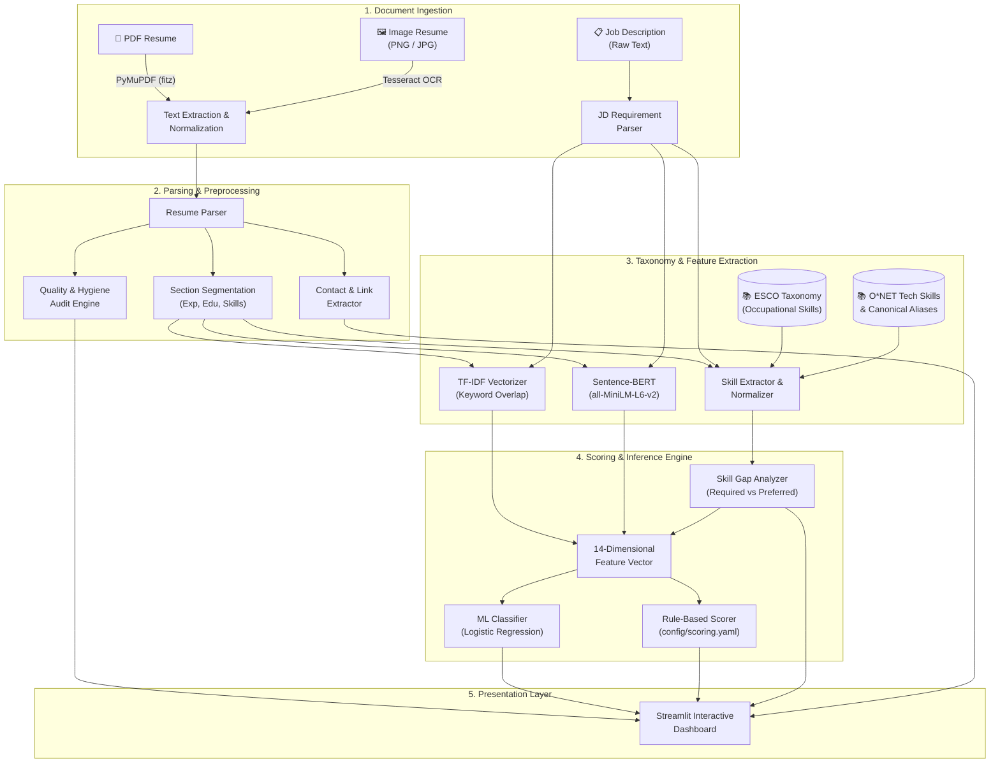

# 🎯 AI Resume Analyzer & Job Fit Matcher

[](https://www.python.org/downloads/)
[](https://streamlit.io)
[](https://pytorch.org)
[](https://huggingface.co)
[](https://www.docker.com/)
[](LICENSE)

An intelligent, fully local NLP and machine learning platform designed to audit resumes, extract skills against standardized taxonomies, evaluate ATS readability, and compute explainable alignment against job descriptions—**completely free of external cloud LLM APIs**.

---

## 📌 Table of Contents

- [Overview](#-overview)
- [Key Features](#-key-features)
- [System Architecture](#-system-architecture)
- [Machine Learning & Scoring Pipeline](#-machine-learning--scoring-pipeline)
  - [Taxonomy & Skill Extraction](#taxonomy--skill-extraction)
  - [Lexical & Semantic Matching](#lexical--semantic-matching)
  - [Model Performance & Evaluation](#model-performance--evaluation)
  - [Explainable Hybrid Scorer](#explainable-hybrid-scorer)
- [Project Directory Structure](#-project-directory-structure)
- [Getting Started](#-getting-started)
  - [Prerequisites](#prerequisites)
  - [Option 1: Docker (Recommended)](#option-1-docker-recommended)
  - [Option 2: Local Environment Setup](#option-2-local-environment-setup)
- [Running the Pipelines](#-running-the-pipelines)
  - [Data Ingestion](#1-data-ingestion)
  - [Skill Taxonomy Preparation](#2-skill-taxonomy-preparation)
  - [Model Training & Benchmarking](#3-model-training--benchmarking)
  - [Running Unit Tests](#4-running-unit-tests)
- [Configuration & Heuristics](#-configuration--heuristics)
- [Limitations & Ethical Considerations](#-limitations--ethical-considerations)
- [Acknowledgments](#-acknowledgments)

---

## 💡 Overview

Modern job seekers face two primary hurdles: opaque Applicant Tracking Systems (ATS) that reject resumes for minor formatting or keyword deficiencies, and generic generative AI tools that hallucinate advice or leak private career data to remote servers.

**AI Resume Analyzer** solves both issues by operating as a **100% private, deterministic, and explainable local engine**:
- **Zero Cloud API Dependencies**: Runs completely offline using local models (Sentence-BERT, Scikit-learn, XGBoost, and PyMuPDF). No personal data or resumes are sent over the network.
- **Explainable & Actionable Insights**: Replaces confusing ML jargon (such as "TF-IDF score" or "F1 metrics") with clear, human-readable suggestions categorized by severity.
- **Context-Aware Feedback**: Adapts expectations based on career seniority (*Fresher / Student*, *Mid-Level*, *Senior*) and target domain.

---

## ✨ Key Features

### 1. 🔍 Deep Resume Quality & Hygiene Audit
Scans resumes across multiple dimensions, returning clear issue cards with severity ratings (**Critical**, **High**, **Medium**, **Minor**), location tags, and exact remediation advice:
- **Contact & Profile Completeness**: Detects email, phone number, LinkedIn, and GitHub links. Flags missing core sections (*Experience, Education, Skills, Projects*).
- **Writing & Style Analysis**: Detects overused buzzwords and empty clichés (*"team player"*, *"hardworking"*, *"results-driven"*) and recommends evidence-based replacements.
- **Repetitive & Weak Phrasing**: Identifies repetitive action verbs and flags passive duty statements (*"responsible for"*, *"duties included"*).
- **Quantification Audit**: Checks whether bullet points demonstrate impact with metrics (`%`, `$`, scale, multipliers, user counts).
- **Bullet Point Length & Density**: Flags overly long bullets (>40 words) that hurt readability, as well as under-informative short lines.
- **Privacy & Bias Protection**: Flags unnecessary personal details (*Date of Birth, Age, Marital Status, Gender, Nationality*) that should not appear on professional resumes.
- **Formatting & Consistency**: Verifies date format consistency across timelines and flags mixed tense usage in past experience sections.

### 2. 🎯 Job Description Alignment (Optional Mode)
When a Target Job Description is supplied, the engine runs an in-depth comparative audit:
- **Standardized Skill Gap Analysis**: Uses taxonomy-backed matching to categorize candidate skills into **Matched Required**, **Missing Required**, and **Missing Preferred** competencies.
- **Dual Matching Engine**:
  - *Lexical Alignment (TF-IDF)*: Measures exact keyword vocabulary overlap.
  - *Semantic Alignment (Sentence-BERT)*: Captures contextual similarity even when phrasing differs (e.g., *"Kubernetes orchestration"* vs. *"container deployment"*).
- **Experience & Education Verification**: Automatically compares job requirements against resume qualifications and identifies discrepancies.

### 3. 🎨 Streamlined, Modern UI
- Clean, dark-mode Streamlit dashboard with radial score gauges.
- Color-coded skill pills, severity-tagged diagnostic cards, and copy-paste-ready suggestions.
- Multi-format ingestion supporting **PDF** (PyMuPDF) and **Images/Scans** (Tesseract OCR).

---

## 🏗 System Architecture

The pipeline processes resumes and job descriptions through deterministic parsers, specialized feature extractors, and a hybrid scoring engine:



---

## 🔬 Machine Learning & Scoring Pipeline

### Taxonomy & Skill Extraction
The system integrates two occupational taxonomies preprocessed into local lookup tables (`data/skills/`):
1. **ESCO (European Skills, Competences, Qualifications and Occupations)**: Mapped from ESCO v1.2.0 and the `jjzha/skillspan` annotated corpus.
2. **O*NET Technology Skills**: Curated from the U.S. Department of Labor database.
3. **Skill Normalization Engine**: Maps abbreviations, aliases, and synonymous tools (e.g., `k8s` → `kubernetes`, `react.js` → `react`, `postgres` → `postgresql`) to unified canonical concepts.

### Lexical & Semantic Matching
- **TF-IDF N-Gram Vectorizer**: Computes sublinear TF-IDF word and bi-gram cosine similarities to evaluate keyword overlap.
- **Dense Embeddings (Sentence-BERT)**: Uses `sentence-transformers/all-MiniLM-L6-v2` (384-dimensional dense vectors) to compute semantic cosine similarity across resume experiences and job requirements.

### Model Performance & Evaluation
Supervised classifiers were trained on the **`med2425/resume-job-fit-merged-v1`** dataset (93,733 candidate-job pairs) across three classes: *Good Fit*, *Potential Fit*, and *No Fit*.

#### Feature Vector (14 Dimensions)
1. `tfidf_similarity` (Lexical similarity score)
2. `sbert_similarity` (Semantic embedding cosine similarity)
3. `skill_coverage` (Overall skill intersection ratio)
4. `required_skill_coverage` (Matched required skills / Total required skills)
5. `preferred_skill_coverage` (Matched preferred skills / Total preferred skills)
6. `resume_skill_count`
7. `jd_skill_count`
8. `matched_skill_count`
9. `missing_skill_count`
10. `resume_word_count`
11. `jd_word_count`
12. `length_ratio`
13. `education_match` (Binary degree level satisfaction)
14. `experience_match` (Binary years-of-experience satisfaction)

#### Test-Set Benchmark Results

| Model | Accuracy | Macro Precision | Macro Recall | Macro F1 | Weighted F1 |
|:---|:---:|:---:|:---:|:---:|:---:|
| **Logistic Regression** (Selected) | **0.5546** | **0.5448** | **0.5546** | **0.5446** | **0.5446** |
| **XGBoost** | 0.5458 | 0.5460 | 0.5458 | 0.5407 | 0.5407 |

*Note: All reported metrics represent actual held-out test set performance under strict data-leakage controls (scalers and vectorizers fitted exclusively on training splits).*

### Explainable Hybrid Scorer
The composite match score (0–100) is calculated as a transparent weighted sum configured in [`config/scoring.yaml`](file:///Users/adreejaa/Desktop/ai-resume-analyzer/config/scoring.yaml):

$$\text{Match Score} = \sum_{i} w_i \times s_i$$

```yaml
weights:
  required_skill_coverage: 0.30
  semantic_similarity:      0.25
  experience_relevance:     0.15
  tfidf_similarity:         0.10
  ml_model_confidence:      0.10
  education_relevance:      0.05
  preferred_skill_coverage: 0.05

thresholds:
  strong_match:    80
  potential_match: 60
  # Below 60 -> Weak Match
```

---

## 📁 Project Directory Structure

```text
ai-resume-analyzer/
├── app/
│   └── streamlit_app.py           # Streamlit user interface and interactive dashboard
├── config/
│   └── scoring.yaml               # Heuristic weights and match classification thresholds
├── data/
│   ├── raw/                       # Downloaded training and validation parquet datasets
│   ├── samples/                   # Sample resumes (PDF, TXT) and job descriptions for testing
│   └── skills/                    # Preprocessed ESCO & O*NET skill taxonomies & alias mappings
├── models/
│   ├── best_model.joblib          # Trained classification model (Logistic Regression)
│   ├── scaler.joblib              # StandardScaler fitted on training features
│   ├── label_encoder.joblib       # Label encoder for fit categories
│   ├── tfidf_vectorizer.joblib    # TF-IDF vectorizer trained on dataset text
│   ├── model_info.json            # Model metadata, features, and performance summary
│   └── evaluation_report.md       # Full evaluation breakdown and classification reports
├── scripts/
│   ├── download_data.py           # Ingests primary & secondary datasets from Hugging Face
│   ├── prepare_skills.py          # Builds local ESCO & O*NET taxonomy dictionaries
│   └── train_models.py            # End-to-end feature extraction and model training pipeline
├── src/
│   ├── analysis/
│   │   ├── experience_education.py# Extracts and matches years of experience & degree levels
│   │   └── resume_quality.py      # Core heuristic engine for clichés, verbs, metrics, and bias
│   ├── evaluation/
│   │   └── evaluator.py           # Generates confusion matrices and metric comparison tables
│   ├── matching/
│   │   ├── semantic_matcher.py    # Sentence-BERT embedding similarity calculation
│   │   └── tfidf_matcher.py       # TF-IDF cosine similarity computation
│   ├── models/
│   │   └── trainer.py             # Feature vector builder and model training routines
│   ├── parsing/
│   │   ├── image_parser.py        # OCR text extraction from images via PyTesseract
│   │   ├── jd_parser.py           # Parses requirements, qualifications, and role info from JDs
│   │   ├── pdf_parser.py          # High-fidelity PDF text extraction via PyMuPDF
│   │   └── resume_parser.py       # Section segmentation and contact info parsing
│   ├── preprocessing/
│   │   └── text_cleaner.py        # Tokenization, punctuation removal, and stopword cleaning
│   ├── scoring/
│   │   └── scorer.py              # Configurable hybrid scoring logic
│   └── skills/
│       ├── extractor.py           # Extracts and normalizes skills from text
│       ├── matcher.py             # Matches skills and identifies gaps (required vs preferred)
│       └── taxonomy.py            # Taxonomy loader and alias resolver
├── tests/                         # Comprehensive unit and integration test suite
│   ├── test_pdf_parser.py
│   ├── test_preprocessing.py
│   ├── test_resume_quality.py
│   ├── test_scoring_parsing.py
│   └── test_skill_extraction.py
├── .devcontainer/                 # Dev container configuration for VS Code / GitHub Codespaces
├── Dockerfile                     # Container image definition
├── docker-compose.yml             # Container orchestration config
├── packages.txt                   # System dependencies (tesseract-ocr)
└── requirements.txt               # Python package dependencies
```

---

## 🚀 Getting Started

### Prerequisites
- **Python**: 3.10 or 3.11
- **Tesseract OCR** (for image resume parsing):
  - macOS: `brew install tesseract`
  - Ubuntu/Debian: `sudo apt-get install -y tesseract-ocr`
  - Windows: [UB-Mannheim Tesseract installer](https://github.com/UB-Mannheim/tesseract/wiki)

---

### Option 1: Docker (Recommended)

Run the full application inside an isolated container with all system dependencies pre-configured:

```bash
# Clone the repository
git clone -b resume-analyser https://github.com/adreejaa-dash/ai-resume-analyzer.git
cd ai-resume-analyzer

# Build and start container
docker-compose up --build
```

Open your browser and navigate to **`http://localhost:8501`**.

---

### Option 2: Local Environment Setup

1. **Clone the repository and checkout the branch**:
   ```bash
   git clone -b resume-analyser https://github.com/adreejaa-dash/ai-resume-analyzer.git
   cd ai-resume-analyzer
   ```

2. **Create and activate a virtual environment**:
   ```bash
   python3 -m venv venv
   source venv/bin/activate  # On Windows: venv\Scripts\activate
   ```

3. **Install dependencies**:
   ```bash
   pip install --upgrade pip
   pip install -r requirements.txt
   ```

4. **Download NLTK corpora**:
   ```bash
   python3 -c "import nltk; nltk.download('stopwords'); nltk.download('punkt'); nltk.download('punkt_tab')"
   ```

5. **Launch the Streamlit app**:
   ```bash
   streamlit run app/streamlit_app.py
   ```
   The application will launch on `http://localhost:8501`.

---

## ⚙️ Running the Pipelines

### 1. Data Ingestion
To re-download the training and validation datasets from Hugging Face:
```bash
python3 scripts/download_data.py
```
*Ingests `med2425/resume-job-fit-merged-v1` into `data/raw/resume_job_fit_train.parquet` and `data/raw/resume_job_fit_test.parquet`.*

### 2. Skill Taxonomy Preparation
To rebuild or update the local ESCO & O*NET skill taxonomy files:
```bash
python3 scripts/prepare_skills.py
```
*Generates `data/skills/esco_skills.csv`, `data/skills/onet_tech_skills.csv`, `skill_aliases.json`, and `skill_categories.json`.*

### 3. Model Training & Benchmarking
To re-extract feature vectors, fit the scalers, train Logistic Regression and XGBoost classifiers, and regenerate evaluation reports:
```bash
python3 scripts/train_models.py
```
*Outputs serialized models to `models/`, writes `models/model_info.json`, and saves confusion matrix plots.*

### 4. Running Unit Tests
Execute the automated test suite across parsing, quality heuristics, skill matching, and scoring:
```bash
pytest
```

---

## 🛠 Configuration & Heuristics

All weights and classification thresholds used by the scoring engine can be configured without modifying code in [`config/scoring.yaml`](file:///Users/adreejaa/Desktop/ai-resume-analyzer/config/scoring.yaml):

```yaml
weights:
  required_skill_coverage: 0.30
  semantic_similarity: 0.25
  tfidf_similarity: 0.10
  experience_relevance: 0.15
  education_relevance: 0.05
  preferred_skill_coverage: 0.05
  ml_model_confidence: 0.10

thresholds:
  strong_match: 80
  potential_match: 60
```

To modify quality rules (e.g., adding banned buzzwords or updating quantified pattern regexes), edit [`src/analysis/resume_quality.py`](file:///Users/adreejaa/Desktop/ai-resume-analyzer/src/analysis/resume_quality.py).

---

## ⚠️ Limitations & Ethical Considerations

- **Application-Defined Quality Score**: The resume quality and fit scores are heuristic educational assessments designed to provide constructive feedback. They do not constitute an official ATS score, guarantee interview calls, or represent hiring decisions.
- **Visual PDF Layout Limitations**: Text extraction parses logical text streams. It does not evaluate visual layout design, multi-column aesthetic balance, or graphic elements.
- **Truthful Optimization**: Users should only incorporate suggested missing skills and keywords if they have genuine, verifiable competence in those areas.

---

## 📚 Acknowledgments

- **European Commission**: For the [ESCO v1.2.0](https://esco.ec.europa.eu/) multilingual occupational skills classification.
- **U.S. Department of Labor**: For the [O*NET](https://www.onetcenter.org/) technology skills database.
- **Hugging Face & Datasets**: For hosting the `med2425/resume-job-fit-merged-v1` and `jjzha/skillspan` datasets.
- **Sentence-Transformers**: For the fast and effective `all-MiniLM-L6-v2` embedding model.
- **PyMuPDF (`fitz`)**: For fast, accurate document extraction.
- **Streamlit**: For the interactive web application framework.
